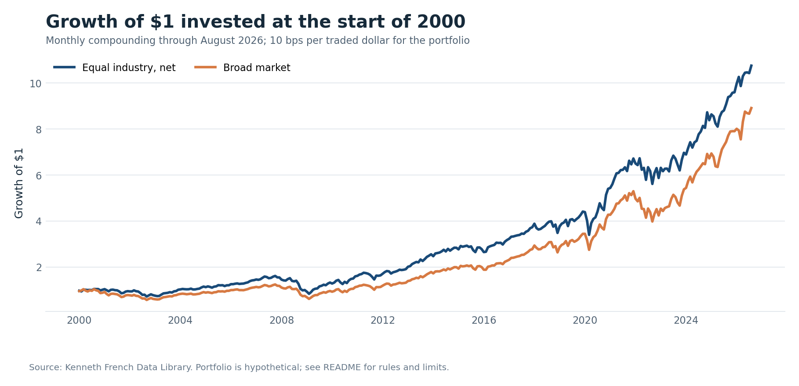
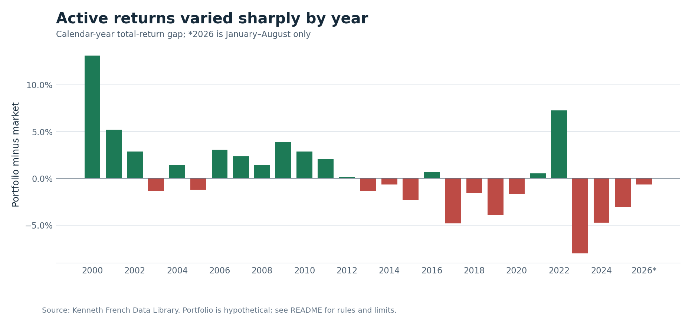
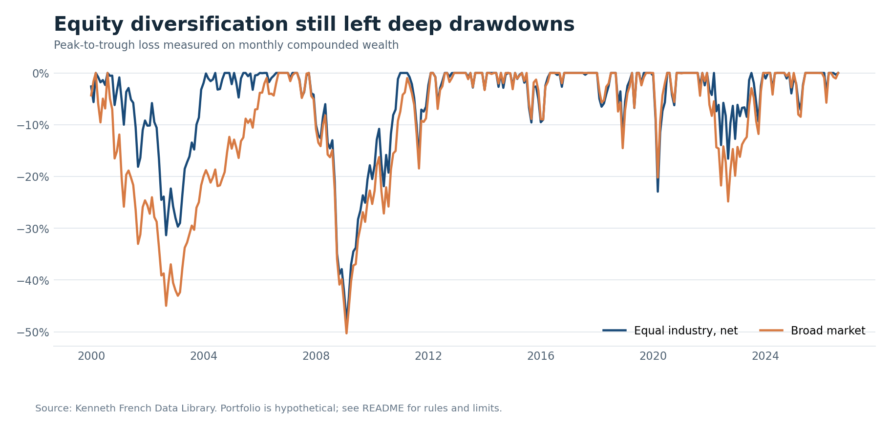
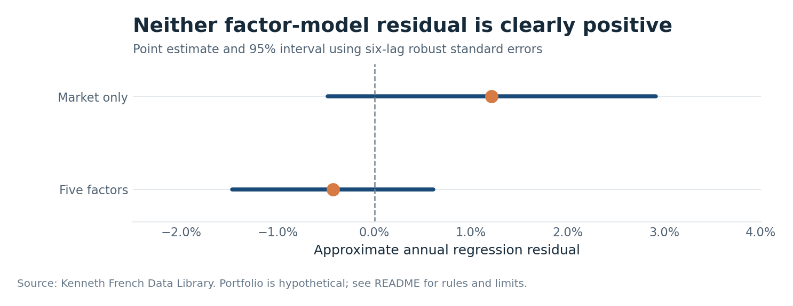

# U.S. Industry Portfolio Analysis

A public-data portfolio analyst case study built as an investment committee style review. It asks: **Did an equal-industry U.S. equity allocation improve on the broad market, and does that result survive risk, factor, period, and implementation checks?**

[Read the full self-contained report](analysis/report.html) · [Review the calculations](analyze.py) · [See validation](analysis/VALIDATION.md)

## Key results

The hypothetical strategy starts each month with 10% in each of ten Kenneth French value-weighted U.S. industry research portfolios. It pays a modeled 10 basis points per dollar traded, including the initial purchase. The benchmark is the Kenneth French broad U.S. market research return, matched month for month.

| January 2000–August 2026 | Equal industry, net | Broad market |
| --- | ---: | ---: |
| Annualized total return | 9.3% | 8.5% |
| Annualized volatility | 14.9% | 15.7% |
| Maximum monthly drawdown | −48.1% | −50.3% |
| Growth of $1 | $10.75 | $8.91 |

The long-window lead is **0.77 percentage points a year**. From January 2015 through August 2026, the portfolio returned **12.1%**, behind the market’s **13.7%**. Its five-factor regression residual is negative, and six-lag robust intervals for both the market-only and five-factor residuals include zero. This evidence does not establish manager skill or a durable investment edge.









## What the analysis covers

- **Performance:** compounded and annualized total returns, calendar-year returns, 2026 year-to-date results, and rolling five-year comparisons.
- **Risk:** annualized volatility, Sharpe ratio using the matching risk-free series, market beta, tracking error, and monthly peak-to-trough drawdown.
- **Attribution and exposures:** gross arithmetic contribution from each industry and descriptive market-only and five-factor regressions. Industry contribution is not Brinson attribution because benchmark industry weights are unavailable.
- **Context and implementation:** FRED recession and CPI checks, modeled turnover, 0–100 basis point trading-cost sensitivity, and limits of replicating research portfolios with actual funds.

## Sources and provenance

- [Kenneth French Data Library](https://mba.tuck.dartmouth.edu/pages/faculty/ken.french/data_library.html): ten U.S. industry portfolios and the five-factor series, including the matching market excess return and risk-free return. The [industry methodology](https://mba.tuck.dartmouth.edu/pages/faculty/ken.french/data_library/det_10_ind_port.html) explains SIC-based industry assignment and annual reconstitution. The captured data cut is August 2026.
- [FRED USREC](https://fred.stlouisfed.org/series/USREC): monthly NBER-based recession indicator.
- [FRED CPIAUCSL](https://fred.stlouisfed.org/series/CPIAUCSL): monthly seasonally adjusted consumer price index. October 2025 is missing in the downloaded vintage; no monthly value is imputed. Full-window purchasing-power comparisons use only CPI endpoints.

The exact source URLs, download timestamps, and SHA-256 hashes are in [analysis/provenance](analysis/provenance/). The source ZIPs and downloaded CSVs are excluded from this repository and recreated by the scripts below. Kenneth French can revise historical returns; refreshing the project may change results.

## Reproduce the analysis

Use Python 3.11 or later. From the repository root:

```powershell
python -m venv .venv
.\.venv\Scripts\python.exe -m pip install -r requirements.txt
.\.venv\Scripts\python.exe refresh_data.py
.\.venv\Scripts\python.exe analyze.py
.\.venv\Scripts\python.exe validate.py
.\.venv\Scripts\python.exe export_charts.py
.\.venv\Scripts\python.exe build_report.py
```

On macOS or Linux, use `.venv/bin/python` in place of `.\.venv\Scripts\python.exe`.

The scripts write raw downloads to `data/raw/`, normalized returns to `data/processed/`, and calculation outputs to `analysis/`. `build_report.py` refreshes the report's canonical `analysis/artifact.json` and reviewed snapshot tables. The committed `analysis/report.html` is the self-contained published snapshot. Its enhanced HTML packaging uses the Data Analytics portable report builder available in the Codex environment; the underlying analysis, data checks, and PNG charts need only the dependencies in `requirements.txt`.

## Repository map

| Path | Purpose |
| --- | --- |
| `refresh_data.py` | Download and validate official Kenneth French source files |
| `analyze.py` | Simulate the allocation and calculate performance, risk, factors, macro context, and costs |
| `validate.py` | Independently recompute high-impact results |
| `export_charts.py` | Rebuild the four chart PNGs |
| `build_report.py` | Build the report artifact and reviewed SQL-backed snapshot |
| `analysis/report.html` | Published self-contained investment committee style report |
| `analysis/metrics.json` and `analysis/annual_returns.csv` | Compact, auditable results |
| `analysis/provenance/` | Source URLs, timestamps, and hashes |
| `charts/` | Publication-ready PNG charts shown above |

## Method and limits

All processed returns are decimal monthly total returns. `market_total_return = Mkt-RF + RF`. The simulation rebalances to 10% per industry at the start of each month; cost is charged on dollars bought and sold. Annual returns are geometric; annualized volatility and tracking error multiply monthly standard deviations by √12; drawdown is calculated from compounded month-end wealth. Factor residuals are 12 times monthly regression intercepts, with approximate 95% intervals using six-lag Newey-West standard errors.

These are **constructed research portfolios**, not live fund holdings or an executable strategy. The modeled cost does not include fund expense ratios, taxes, market impact, internal portfolio reconstitution costs, or cash drag. The benchmark is shown without an implementation fee. Results depend on the start date, and overlapping rolling windows are not independent observations. The case study is historical research, not personalized investment advice.

The strongest next extension is an investable sector-fund replication with inception-date controls and actual expenses. A separate [SEC 13F holdings](https://www.sec.gov/data-research/sec-markets-data/form-13f-data-sets) study could add position concentration, but quarterly filings are delayed and do not reveal all intervening trades.
